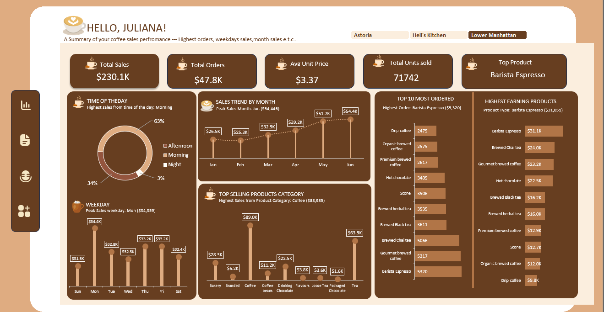
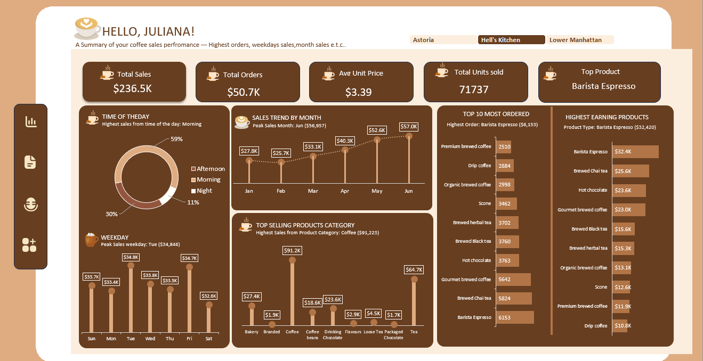
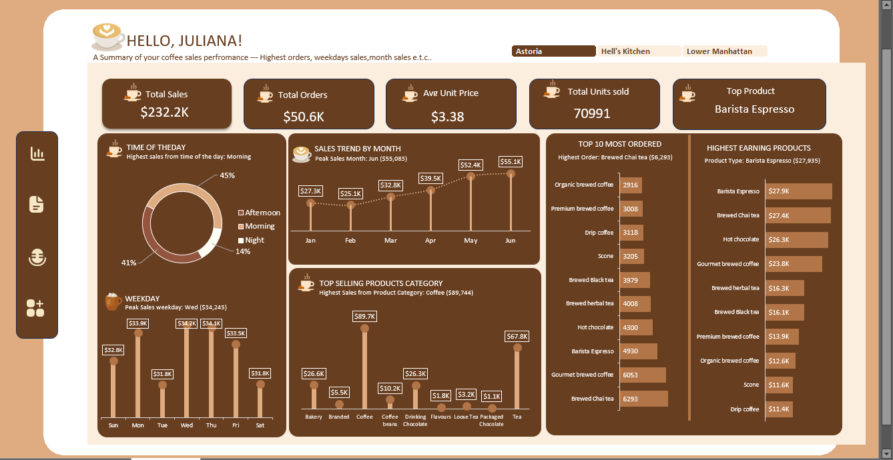

# coffee-sale-analysiss-excel-sql
#  Coffee Sales Performance Analysis: Excel Dashboard and PostgreSQL Validation

## 1. Project Overview

This project analyses coffee sales across three store locations: Lower Manhattan, Hell's Kitchen, and Astoria, using Microsoft Excel and PostgreSQL.

I started by preparing the dataset, creating calculated columns, and building an interactive Excel dashboard to track sales performance, identify peak sales periods, compare product performance, and examine differences across store locations.

I then recreated the key calculations and aggregations in PostgreSQL to  compare and validate the results with my Excel analysis.

The project covers six months of sales data, from January to June 2023, and focuses on turning sales records into insights that can help support business decisions.

## 2. Business Problem

The coffee chain operates three stores across Astoria, Hell’s Kitchen, and Lower Manhattan. To make informed operational and commercial decisions, management needs a clear understanding of how sales performance varies across the business.

Without a consolidated view of sales data, it can be difficult to identify areas that require attention, allocate resources effectively, and determine where changes to product offerings or sales strategies may be worth exploring.

This project uses six months of sales data, from January to June 2023, to provide a consolidated view of the business's performance and support data-informed decision-making.

### 3. Dataset Description
The dataset was sourced from Kaggle and comprises raw POS (Point of Sale) transaction logs spanning a 6-month operational period (January 2023 – June 2023). [Excel_Workbook_Sheet](/Coffee_Sales_Analysis.xlsx)

Dataset Metadata & Schema Summary
- Total Raw Records: 149,116 transaction records
- Total Units Sold: 214,470 units
- Timeframe: January 1, 2023 – June 30, 2023
- Geographic Scope: 3 Stores (Astoria, Hell's Kitchen, Lower Manhattan)

## 4. Business Questions
To understand the business performance and support better decision-making, this analysis focuses on answering the following business questions:

Executive KPIs
- What is the total gross revenue generated across all locations?
- What is the total order volume, total unit volume, and average unit price?
- What is the single highest-earning product across the entire chain?

Temporal & Operational Trends
- How is sales revenue distributed across operational shifts (Morning vs. Afternoon vs. Night)?
- Which day of the week generates peak revenue
- What is the month-over-month sales growth trajectory across the 6-month period?

Product Performance 
- Which top 5 product categories contribute the largest share to total sales?
- Which specific product types dominate transaction order volume (Top 10 Most Ordered)?
- Which specific product types dominate gross revenue generation (Top 10 Highest Earning)?
- Does a discrepancy exist between customer order frequency and total dollar return?

Geographic & Slicer Analysis
- How do sales KPIs, shift patterns, and product preferences shift when filtering specifically by Lower Manhattan, Hell's Kitchen, and Astoria?

## 5. Tools and Commands
#### Microsoft Excel:

Used for data inspection, preparation, feature engineering, and interactive dashboard development.

- Data Cleaning and Preparation: Inspected the raw dataset for missing values, duplicate transaction IDs, and inconsistencies in date and time fields.

- Feature Engineering: Created calculated columns to support time-based and multidimensional sales analysis.

- Dynamic Lookup Formulas: Used INDEX, MATCH, and MAX to build dynamic lookup functionality and display selected results using custom number and text formatting.

- Interactive Dashboard Development: Designed an interactive dashboard incorporating timeline slicers, visual hierarchy, custom colour branding, and shape-based containers to improve navigation and readability.

#### PostgreSQL Analysis

PostgreSQL was used to analyse the coffee sales dataset and validate key metrics against the Excel dashboard.

The analysis covered:

- **Data Ingestion:** Created a database table and imported the coffee sales dataset using `COPY`.
- **Sales Metrics:** Used `SUM()`, `AVG()`, and `COUNT()` to calculate key performance indicators.
- **Sales Performance Analysis:** Used `GROUP BY` and `ORDER BY` to analyse revenue by product, weekday, and time of day.
- **Product Ranking:** Identified the highest-revenue product, top five product categories by revenue, and top 10 product types based on the selected ranking metric.
- **Cross-Validation:** Compared PostgreSQL query results with the corresponding Excel calculations to check consistency across both tools.

## 6. Data Cleaning and Preparation
Data preparation was performed in Microsoft Excel before the dataset was structured and loaded into PostgreSQL for analysis.

Step 1: Data Import and Structural Inspection

- The raw CSV file was imported into Microsoft Excel for initial inspection.

- The dataset was reviewed for structural issues, missing values, duplicate transaction IDs, and inconsistencies in date and time fields.

Initial checks indicated:

- No missing values were identified, no duplicate transaction IDs were identified.

Step 2: Data Type Standardisation

Columns were reviewed and prepared for analysis using appropriate data types and formats.
E.g: 
- transaction_id, store_id, product_id, transaction_qty: Whole number

- transaction_date: Date (YYYY-MM-DD)

- transaction_time: Time (HH:MM:SS)

- unit_price: Currency

Step 3: Feature Engineering

Five calculated columns were created to support more detailed sales analysis.

- Time of Day Bucket (Operational Shift): Evaluated raw timestamp to categorize sales into operational shifts:
- Day of Week: Extracted three-letter abbreviated weekday strings from Column "transaction_date"
  
- Month Name: Extracted three-letter abbreviated month strings from Column "transaction_date"

- Extracted four-digit calendar year from Column "transaction_date"

- Total Line Sales: Calculated line item gross revenue by multiplying quantity by unit price

## 7 Exploratory Data Analysis and Methodology
The analytical methodology followed a structured 3-stage process:

| Phase | Activities |
|---|---|
| **Phase 1: Excel Pivot Engine** | • Built  `Pivot` worksheet. • Calculated key performance indicators (KPIs). • Created dynamic peak-value lookup text cards. |
| ↓ | **Followed by Phase 2: Visual Dashboard Architecture** |
| **Phase 2: Visual Dashboard ** | • Structured five metric cards. • Created doughnut, bar, and line charts. • Connected slicers across PivotTables. |
| ↓ | **Followed by Phase 3: PostgreSQL Cross-Reconciliation** |
| **Phase 3: PostgreSQL Cross-Reconciliation** | • Created the SQL database table schema. • Loaded 14,116 rows using `COPY`. • Replicated the Excel aggregations using SQL queries. |

## 8 Complete PostgreSQL Query Implementation
Below is the full, unedited PostgreSQL script executed to validate the Excel outputs:
[SQL Analysis Code](./coffee_sales_analysis.sql)

## 9. Dashboard, Key Findings and Business Interpretation

The interactive Excel dashboard was designed using a Warm Roast Coffee colour palette, with KPI cards, charts and slicers to support the exploration of sales performance across products, time periods and store locations.

### A. Overall Coffee Sales Performance

The analysis covered 149,116 sales records from January to June 2023 across three store locations. The following KPIs summarise the overall performance of the business.

| Performance Metric | Result |
|---|---:|
| Total Sales Revenue | $698,812.33 |
| Total Transaction Records | 149,116 |
| Average Unit Price | $3.38 |
| Total Units Sold | 214,470 |
| Top Product by Revenue | Barista Espresso ($91,406) |
| Best-Performing Month | June ($166,486) |
| Best-Performing Weekday | Monday ($101,677) |

June recorded the highest monthly revenue, while Monday generated the highest revenue among the weekdays. These results provide a starting point for further analysis of sales patterns and business performance.

### B. Product Performance: Order Volume vs. Revenue

The product analysis showed that the products with the highest order frequency did not necessarily generate the highest revenue.

- **Brewed Chai Tea:** Ranked first by order volume, with 17,183 orders and approximately $77,125 in sales revenue.
- **Barista Espresso:** Ranked third by order volume, with 16,403 orders, but generated the highest revenue at $91,406.

Despite recording fewer orders, Barista Espresso generated $14,281 more in revenue than Brewed Chai Tea. This highlights the value of assessing products using both order volume and revenue rather than relying on a single performance measure.

### C. Sales Performance Across Store Locations

The dashboard slicers enabled comparisons of sales performance, time-of-day patterns and product results across Lower Manhattan, Hell's Kitchen and Astoria.

**Store comparison views**

- 

- 

- 

| Performance Metric | Lower Manhattan | Hell's Kitchen | Astoria |
|---|---:|---:|---:|
| Total Sales Revenue | $230.1K | $236.5K | $232.2K |
| Transaction Records | 47.8K | 50.7K | 50.6K |
| Average Unit Price | $3.37 | $3.39 | $3.38 |
| Total Units Sold | 71,742 | 71,737 | 70,991 |
| Morning Sales Share | 63% | 59% | 45% |
| Afternoon Sales Share | 34% | 30% | 41% |
| Night Sales Share | 3% | 11% | 14% |
| Peak Sales Weekday | Monday ($34.4K) | Tuesday ($34.8K) | Wednesday ($34.2K) |
| Peak Sales Month | June ($54.4K) | June ($57.0K) | June ($55.1K) |
| Top Revenue Category | Coffee ($88.9K) | Coffee ($91.2K) | Coffee ($89.7K) |
| Top Product by Revenue | Barista Espresso ($31.1K) | Barista Espresso ($32.4K) | Barista Espresso ($27.9K) |

Hell's Kitchen recorded the highest total revenue, although revenue, average unit price and units sold were broadly similar across the three locations. The more noticeable differences were in the distribution of sales across time periods and the peak sales weekday at each store.

Morning accounted for the largest share of sales in all three locations, but its contribution varied from 45% in Astoria to 63% in Lower Manhattan. Astoria also recorded a higher share of afternoon and night sales than the other locations. These patterns suggest that demand should be assessed at the individual-store level when reviewing staffing and inventory plans.

June was the highest-revenue month for all three stores, and Barista Espresso was the leading product by revenue at each location. Further analysis of transaction volumes, product mix and available promotional or operational records could help explain the patterns observed, as the sales figures alone do not establish their underlying causes.

## 10. Business Recommendations

Based on the findings, the following actions could be explored and evaluated using additional operational data.

### 1. Test bundles to increase the value of Brewed Chai Tea purchases

Explore bundles pairing Brewed Chai Tea with pastries or snacks, such as scones. Compare transaction value and sales performance before and during the test to determine whether the bundles encourage additional purchases.

### 2. Test ways to improve Barista Espresso's sales performance

Evaluate options such as more prominent menu placement or staff recommendations to buyers. Track product revenue and units sold before and during the test to determine whether these changes improve performance.

### 3. Evaluate a potential price adjustment for Brewed Chai Tea

A controlled price test could help assess how a price change affects demand and revenue. If a 5% increase is tested in a selected location, monitor units sold, revenue and available cost or margin data before considering a wider change.

### 4. Review staffing and inventory against store-level demand

Compare sales by time period with staffing availability and stock usage at each location. Use the results to assess whether shift schedules or inventory allocations could be adjusted to better match demand.

### 5. Investigate the factors associated with June's performance

Examine monthly transaction volumes, product mix and available promotional or operational records to identify factors that may explain June's higher sales. Use the findings to inform future planning where the patterns are repeatable.

## Author and Contact
Fatolu Adedoyin Juliana

Data Analyst | Statistics Graduate | Research Analyst

- **LinkedIn:** [Fatolu Adedoyin Juliana](https://www.linkedin.com)
- **GitHub Profile:** [fajuliana-source](https://github.com/fajuliana-source)
- **Email:** fatoluadedoyin46@gmail.com
